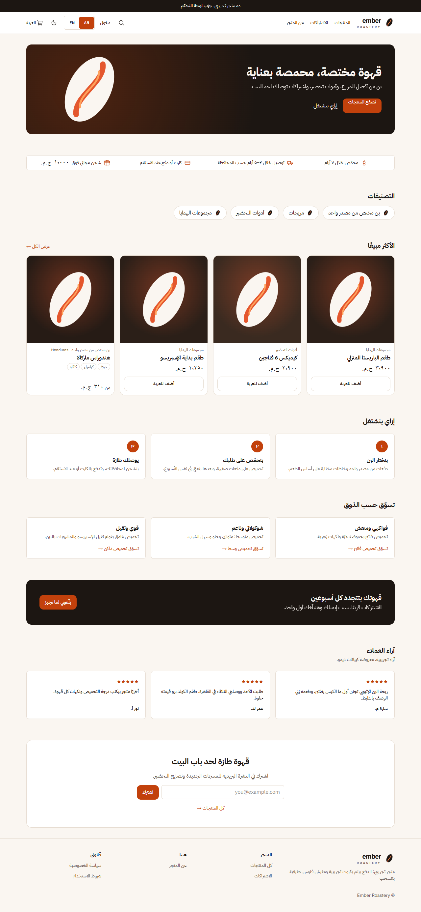
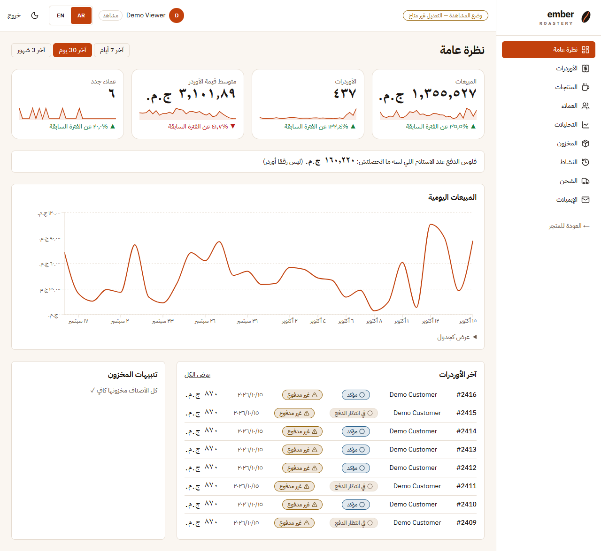
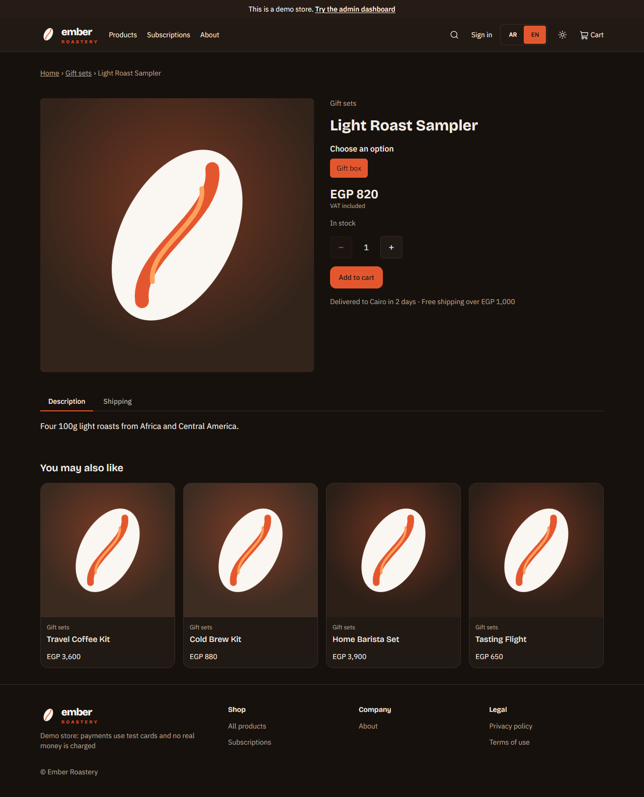
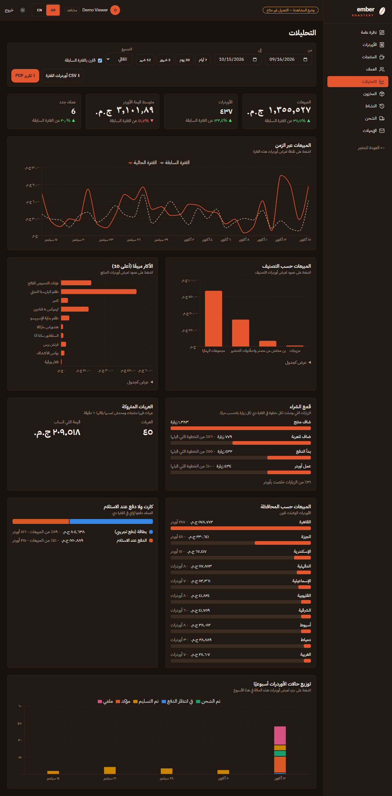

# Ember Roastery: storefront + admin dashboard


A full-stack specialty-coffee shop for Egypt: a customer **storefront** and a live **admin dashboard** on one Next.js app and one Postgres database. An order placed in the store shows up in the dashboard; an edit in the dashboard shows up in the store. Arabic (right to left) and English, light and dark, phone first.

**Demo accounts** (password `Password123`): the login page has two one-click buttons, **Try as customer** (`customer@coffee.test`, with order history and a saved address) and **Try the admin dashboard** (`viewer@coffee.test`, read-only). `admin@coffee.test` has full access. Card payments use the built-in test gateway: `4242 4242 4242 4242` succeeds, `4000 0000 0000 0002` is declined, `4000 0000 0000 9995` has insufficient funds. Cash on delivery needs nothing.


| Storefront                                                        | Dashboard                                                             |
| ----------------------------------------------------------------- | --------------------------------------------------------------------- |
|       |         |
|  |  |

More: [home on a phone](docs/screenshots/store-home.mobile-light.png) · [catalog](docs/screenshots/store-products.desktop-light.png) · [filters sheet on a phone](docs/screenshots/store-products.mobile-light.png) · [login](docs/screenshots/login.desktop-light.png) · [my account](docs/screenshots/account.desktop-light.png) · [orders](docs/screenshots/admin-orders.desktop-light.png) · [orders on a phone](docs/screenshots/admin-orders.mobile-light.png) · [customers](docs/screenshots/admin-customers.desktop-light.png) · [products](docs/screenshots/admin-products.desktop-light.png) · [activity](docs/screenshots/admin-activity.desktop-light.png) · [shipping](docs/screenshots/admin-shipping.desktop-light.png) · [e-mails](docs/screenshots/admin-emails.desktop-light.png) · [English dashboard](docs/screenshots/admin-overview-en.desktop-light.png)

## Run it locally (3 commands)

Needs Node 22+ and Docker (for Postgres).

```bash
docker compose up -d && cp .env.example .env     # Postgres on :5440, the env defaults match it
npm install && npm run db:setup                   # migrate + seed 40 products, 500 customers, 20,000 orders
npm run dev                                       # http://localhost:3000
```

`SEED_ORDERS=50000 npm run db:seed` loads the larger data set used for the numbers below. Every optional service (e-mail, Redis rate limiting, image hosting, Sentry, Google sign-in) is off until its keys are set, and the app works without any of them: see `.env.example`.

## What's in it

**Storefront.** A landing page built to sell (demo bar, hero, trust bar, best sellers with one-click add, how it works, shop by taste, subscription teaser, reviews, newsletter) · a catalog with typo-tolerant search ("ethopia" finds Ethiopia and says so), category, roast, taste, price slider and stock filters shown as removable chips, best-selling sort, everything in the URL, and a bottom sheet for the filters on phones · product pages with gallery, variants, quantity, VAT and delivery lines, tabs and related products · a cart that survives reloads and merges into the account cart on sign-in · checkout with governorate-based shipping, 14 % VAT included, card (test gateway) or cash on delivery · order confirmation with the estimated delivery date and the PDF invoice in Arabic or English · my account with orders that open to their progress, saved addresses and language · "tell me when it's back" for sold-out items.

**Dashboard.** Overview with KPI sparklines, cash on delivery still to collect, sales chart and low-stock alerts · an orders table with server-side paging, sorting and filters (dates, statuses, payment, method, governorate, total, search) shown as removable chips, column visibility, bulk status change and CSV export · order detail with a timeline, guarded status changes, refund and invoice · products with a bilingual form, variants, signed image upload and a visibility switch · stock history · customers with lifetime value and a side panel · analytics with comparison to the previous period, conversion funnel, abandoned carts, sales by category, product, governorate and payment method, a drill-down into the orders table, and a PDF report · activity log of everything that changed (orders, stock, products, prices, shipping) · editable shipping zones · e-mail log with a preview pane.

**Behind it.** Order and payment status are separate; stock is deducted with a conditional update so the last bag is never sold twice; a signed, idempotent payment callback; abandoned card sessions expire; three scheduled jobs (expire payments, simulate a day of activity, reset the demo); roles enforced in the proxy, in every route and in the UI; Content Security Policy and hardening headers; OpenAPI and Swagger.

## Languages (Arabic / English)

- `next-intl` with `/ar` (default, right to left) and `/en`; the switcher keeps the page and query string. All text lives in `messages/{ar,en}/*.json`; a test fails if a key is missing in either language, if placeholders differ, or if Arabic text appears in the source.
- The API returns codes, never prose; the client translates them (`useErrorText`).
- Money and numbers follow the language (`١٬٢٥٠ ج.م.` and `EGP 1,250`); order numbers, SKUs and codes stay Latin in monospace. Dates are on the Cairo calendar.
- Product names, descriptions, categories and shipping zones are stored in both languages and edited through language tabs. E-mails and the invoice use the customer's language and direction.

## Design system

Tokens (OKLCH, generated from `src/lib/brand.ts`), primitives, patterns and a linter that rejects physical left/right classes, palette colors and one-off spacing. IBM Plex Sans / Sans Arabic / Mono with Bricolage Grotesque for English headings, Lucide line icons. **Storybook** shows every component in light and dark, in English and Arabic, with an automated accessibility scan (`npm run storybook`, `npm run test:stories`). Details in [docs/design-system.md](docs/design-system.md).

## Stack

Next.js 16 (App Router, Cache Components) · React 19 · TypeScript · PostgreSQL with `pg_trgm` + Prisma 7 · Better Auth · Zod + React Hook Form · TanStack Query and Table · Zustand · Recharts · Tailwind CSS 4 · next-intl · React Email + Resend · `@react-pdf/renderer` · pino + Sentry · Upstash Redis · Cloudinary · Storybook · Vitest + Playwright + k6.

```
src/app/[locale]/(store)   storefront            src/lib/services   all rules and database access
src/app/[locale]/(admin)   dashboard (guarded)   src/lib/validations Zod schemas shared by forms, API and OpenAPI
src/app/[locale]/(auth)    sign in, register     src/components/ui, patterns   the design system
src/app/api                thin route handlers   prisma/            schema, migrations, seed
```

## Measured results

**Lighthouse** on 7 pages (home in Arabic and English, catalog, product, cart, login and the signed-in dashboard), light and dark, phone and desktop (`npm run lighthouse`, 28 audits, results in `docs/lighthouse.json`):

| Lighthouse (production build)                     | Performance | Accessibility | Best practices | SEO | LCP (median) | CLS (max) |
| ------------------------------------------------- | ----------- | ------------- | -------------- | --- | ------------ | --------- |
| Desktop, light                                    | 99–100      | 100           | 100            | 100 | 0.8 s        | 0.023     |
| Desktop, dark                                     | 99–100      | 100           | 100            | 100 | 0.8 s        | 0.011     |
| Phone (simulated slow 4G, 4× CPU slowdown), light | 86–97       | 100           | 100            | 100 | 3.2 s        | 0.06      |
| Phone (simulated slow 4G, 4× CPU slowdown), dark  | 84–94       | 100           | 100            | 100 | 3.5 s        | 0.06      |

Accessibility, best practices and SEO are 100 on every page. On the phone preset the score is set by the throttling, not by the page: the home page scores 100 with no throttling (LCP 0.3 s); the simulated slow connection has to fetch the Arabic font files and the render-blocking stylesheet first. The catalog's first screenful of images streams in after the search parameters are read, which is why it is the lowest phone score.

**Dashboard API** on 50,004 orders, 500 customers, local Postgres 16, production build (`npm run perf`, median of 15 runs):

| Endpoint                                            |            Median |                p95 |
| --------------------------------------------------- | ----------------: | -----------------: |
| Orders, first page                                  |             91 ms |             116 ms |
| Orders, sorted by total / by customer               |      100 / 102 ms |       140 / 150 ms |
| Orders, status + date filter                        |            110 ms |             156 ms |
| Orders, payment status + method filter              |             82 ms |             107 ms |
| Orders, search by name                              |             95 ms |             132 ms |
| Orders, page 500 of 100 rows                        |            150 ms |             192 ms |
| Orders, drill-down by category (joins items)        |            198 ms |             364 ms |
| Analytics: summary / time series (+previous period) |       149 / 79 ms |       207 / 129 ms |
| Analytics: top products / by category / status mix  | 142 / 168 / 90 ms | 208 / 352 / 119 ms |
| Analytics: governorates / payment methods / carts   |   56 / 51 / 22 ms |    90 / 75 / 80 ms |
| Analytics: conversion funnel (the slowest)          |            284 ms |             331 ms |
| Customers with lifetime value                       |             77 ms |             204 ms |

Every median is under the 300 ms target and every p95 under the 500 ms line at which a summary table would have been added, so none was. (Each request now also reads its session from the database, which is part of these numbers.) A full **CSV export of all 50,004 rows streams in 3.2 s** (6.3 MB) in batches, so memory stays flat.

**Load test** (k6, `tests/load/checkout.js`) against the same 50,004-order database on a single laptop that also ran Postgres, the server and k6 itself: 25 shoppers ramping up, each browsing, signing in and placing a cash-on-delivery order, plus 3 staff reading the analytics, for 80 s.

|                                     | Result                                |
| ----------------------------------- | ------------------------------------- |
| Requests                            | 2,359 (29 per second), **0 % failed** |
| Browse (catalog and product), p95   | 343 ms                                |
| Place an order, p95                 | 1.11 s                                |
| Dashboard analytics and orders, p95 | 680 ms                                |

It shows the shape, not capacity: a hosted database and several instances would do far better. Orders placed this way are written to whatever database the server points at, so run it against a throwaway one.

## Tests

```bash
npm test               # 139 unit and service tests (Vitest, throwaway database created automatically)
npm run test:e2e       # 346 end-to-end tests (Playwright, real Chrome, desktop and phone)
npm run test:stories   # 109 accessibility scans: every Storybook story, light and dark, English and Arabic
```

The suites cover the money paths (two buyers for the last item, a payment confirmation delivered twice, an expired session, the automatic refund), every analytics definition, access control (signed-out, customer, viewer, other customers' data), the Arabic and English text, and every screen in both themes and both languages with axe. [docs/testing.md](docs/testing.md) lists what each file covers. CI (`.github/workflows/ci.yml`) runs formatting, lint, types, unit, end-to-end, Storybook and commit-message checks on every pull request.

## Documentation

|                                                                                        |                                                                    |
| -------------------------------------------------------------------------------------- | ------------------------------------------------------------------ |
| [Architecture](docs/architecture.md)                                                   | layers, protection, the order flow, jobs, optional services        |
| [Business rules](docs/business-rules.md)                                               | analytics definitions, life cycle, shipping, VAT, stock, demo data |
| [Data model](docs/data-model.md) · [ERD](docs/erd.md)                                  | every table and why the order keeps a copy of what was sold        |
| [API](docs/api.md) · `/api/docs`                                                       | conventions and every endpoint; Swagger UI and OpenAPI JSON        |
| [Design system](docs/design-system.md)                                                 | tokens, primitives, patterns, lint rules                           |
| [Decisions](docs/decisions/README.md)                                                  | 17 short records: problem, alternatives, choice, consequences      |
| [Testing](docs/testing.md) · [Deployment](docs/deployment.md)                          | how to run and what is covered; Vercel + Neon, variables, cron     |
| [Case study](docs/CASE_STUDY.md) · [Ideas](docs/ideas.md) · [Credits](docs/credits.md) | the three hard problems; what is out of scope; fonts and images    |
| [CHANGELOG](CHANGELOG.md) · [CONTRIBUTING](CONTRIBUTING.md)                            | history; branches, commits, conventions                            |

## Decisions and trade-offs

- **One Next.js app**, not a separate API: one team and one product. The rules live in services that do not know about HTTP, so an API can be split off later.
- **Built-in test payment gateway** behind a `PaymentProvider` interface: buying never depends on a third party, and the signed callback is the real one a gateway would call.
- **No stock reservation**: a conditional deduction plus an automatic refund covers the same case without reservations to expire.
- **No nonce-based CSP**: it would make every page dynamic; the static storefront shell is worth more here (decision 0010).
- **Demo content is labelled**: reviews on the home page, the demo bar, and the test-payment banners say so.

## Known limitations

- Payments are a demo: no real money moves and no real shipping is booked. Subscriptions are a "coming soon" page with an interest form.
- Product artwork is generated in the brand's style, not photographs.
- The PDF report is English-only (the built-in PDF fonts have no Arabic shaping); the invoice embeds an Arabic font and is bilingual.
- An unknown product URL renders the not-found page with `noindex` but answers HTTP 200 (the page streams); genuinely unknown routes return 404.
